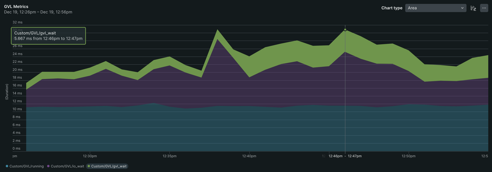

# GVL Metrics Middleware

`gvl_metrics_middleware` is a Ruby gem that monitors the Global VM Lock (GVL) in multi-threaded Ruby applications. This gem uses [the `gvl_timing` gem](https://github.com/jhawthorn/gvl_timing) to measure time spent in the GVL. It then calls your callback with the metrics.

## Installation

Add the gem to your application's Gemfile, and run `bundle install` to install the gem:

```bash
gem 'gvl_metrics_middleware', git: "https://github.com/speedshop/gvl_metrics_middleware.git"
```

## Usage

The `gvl_metrics_middleware` automatically adds itself to your application. To get started, set up a callback to handle the GVL metrics. Put this code in your application's `config/initializers` folder:

```ruby
# config/initializers/gvl_metrics_middleware.rb
GvlMetricsMiddleware.configure do |config|
  # Optional: Set sampling rate (0.0 to 1.0, defaults to 0.01 for 1% sampling)
  config.sampling_rate = 0.1 # Sample 10% of requests/jobs

  config.rack do |total, running, io_wait, gvl_wait|
    # Your code here...
  end

  config.sidekiq do |total, running, io_wait, gvl_wait|
    # Your code here...
  end
end
```

For example, here is how to record the GVL metrics in New Relic.

```ruby
# config/initializers/gvl_metrics_middleware.rb
GvlMetricsMiddleware.configure do |config|
  # Increase sampling from default 1% to 10% for more data
  config.sampling_rate = 0.1

  config.rack do |total, running, io_wait, gvl_wait|
    NewRelic::Agent.record_metric("Custom/Rack/GVL/total", total)
    NewRelic::Agent.record_metric("Custom/Rack/GVL/running", running)
    NewRelic::Agent.record_metric("Custom/Rack/GVL/io_wait", io_wait)
    NewRelic::Agent.record_metric("Custom/Rack/GVL/gvl_wait", gvl_wait)
  end

  config.sidekiq do |total, running, io_wait, gvl_wait, options|
    NewRelic::Agent.record_metric("Custom/Sidekiq/GVL/total", total)
    NewRelic::Agent.record_metric("Custom/Sidekiq/GVL/running", running)
    NewRelic::Agent.record_metric("Custom/Sidekiq/GVL/io_wait", io_wait)
    NewRelic::Agent.record_metric("Custom/Sidekiq/GVL/gvl_wait", gvl_wait)

    # If you want to record metrics for specific queues and job classes, you can do so like this:
    queue = options[:queue]
    job_class = options[:job_class]
    NewRelic::Agent.record_metric("Custom/Sidekiq/GVL/#{queue}/#{job_class}/total", total)
    NewRelic::Agent.record_metric("Custom/Sidekiq/GVL/#{queue}/#{job_class}/running", running)
    NewRelic::Agent.record_metric("Custom/Sidekiq/GVL/#{queue}/#{job_class}/io_wait", io_wait)
    NewRelic::Agent.record_metric("Custom/Sidekiq/GVL/#{queue}/#{job_class}/gvl_wait", gvl_wait)
  end
end
```

After you set this up, you can create custom charts in New Relic to see the GVL metrics. Here is an example chart:



## Available Metrics

The `gvl_metrics_middleware` reports these metrics. All metrics are in nanoseconds.

- **`total`**: The total time to process the request. This equals `running` + `io_wait` + `gvl_wait`. Comes from `GVLTiming::Timer#duration` in `gvl_timing`.
- **`running`**: The time a thread held the GVL and did work. Also called CPU time. Comes from `GVLTiming::Timer#cpu_duration`.
- **`io_wait`**: The time spent waiting for I/O after the thread released the GVL. Comes from `GVLTiming::Timer#idle_duration`.
- **`gvl_wait`**: The time spent waiting to get the GVL. Comes from `GVLTiming::Timer#stalled_duration`.

## Sampling

By default, the middleware samples 1% of requests and jobs to keep overhead low. You can change this rate:
```ruby
GvlMetricsMiddleware.configure do |config|
  # Sample 25% of requests/jobs
  config.sampling_rate = 0.25

  # Your reporters here...
end
```

The `sampling_rate` option takes a value between `0.0` (no sampling) and `1.0` (100% sampling). The default is `0.01` (1%).

The middleware will randomly pick which requests or jobs to measure based on this rate. The default 1% sampling gives you useful metrics while keeping overhead low.

**Important**: Your metrics only show the sampled part of your traffic. You may need to adjust your alerts and analysis to match.

## Performance Overhead

The overhead from `gvl_metrics_middleware` is small. Tests show only a 1% difference in response times. We ran tests with and without GVL metrics. We checked this with an A/A test. Both groups ran the same code. The difference stayed at 1%. This matches what [Shopify's `gvltools`](https://github.com/Shopify/gvltools?tab=readme-ov-file#usage) found. Their overhead was 1-5% in production.

As [the README of `gvltools`](https://github.com/Shopify/gvltools?tab=readme-ov-file#usage) says, the exact overhead is not known yet. But if you don't see a big jump in response times after you deploy, the overhead is small. It will not hurt your app's speed. This makes the middleware good for tracking GVL metrics in production.

## Development

After you check out the repo, run `bin/setup` to install what you need. Then run `rake test` to run the tests. You can also run `bin/console`. This gives you an interactive prompt where you can try things out.

To install this gem on your local machine, run `bundle exec rake install`. To release a new version, update the version number in `version.rb`. Then run `bundle exec rake release`. This will create a git tag for the version. It will push git commits and the tag. It will also push the `.gem` file to [rubygems.org](https://rubygems.org).

## Contributing

Bug reports and pull requests are welcome on GitHub at https://github.com/speedshop/gvl_metrics_middleware. This project should be a safe, welcoming place for everyone. All contributors must follow the [code of conduct](https://github.com/speedshop/gvl_metrics_middleware/blob/main/CODE_OF_CONDUCT.md).

## License

This gem is open source under the [MIT License](https://opensource.org/licenses/MIT).

## Code of Conduct

Everyone who uses the GvlMetricsMiddleware project must follow the [code of conduct](https://github.com/speedshop/gvl_metrics_middleware/blob/main/CODE_OF_CONDUCT.md). This includes codebases, issue trackers, chat rooms, and mailing lists.
